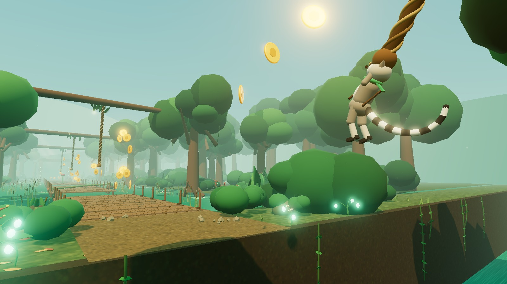
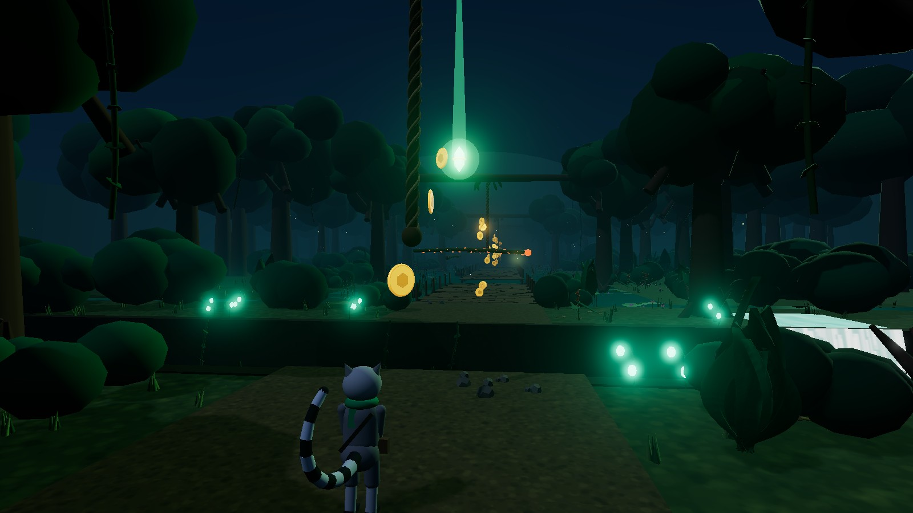
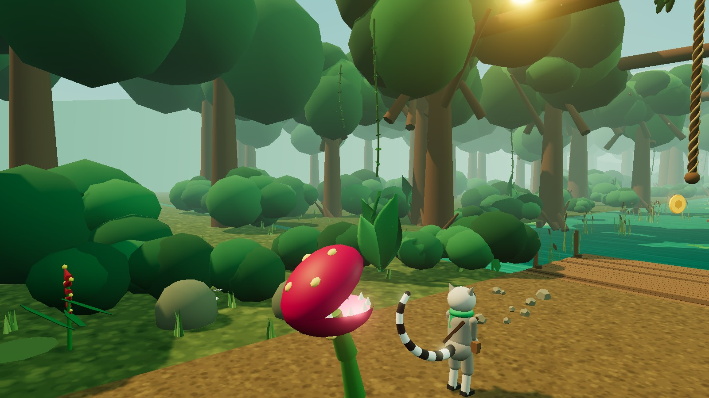

<p align="center">
  
</p>

<h1 align="center">WILDBOUND</h1>

<p align="center">
  <b>Swing, leap and slide through an endless jungle that fights back.</b><br>
  A 3D jungle adventure with a global leaderboard, played right in your browser.
</p>

<p align="center">
  <a href="https://hafsa2n.github.io/Wildbound/"></a>
</p>

<p align="center">
  
  
  
  
  
  
</p>

---

## About

You are a ring-tailed lemur in an emerald bandana, running deeper into the **Emerald Jungle**. The path never ends, the jungle keeps changing, and the plants are out to get you.

Swing across ravines on ropes, read each plant's warning before it strikes, turn the jungle's own traps into tools, and put your best run on the **global leaderboard**.

## Screenshots

<table>
  <tr>
    <td></td>
    <td></td>
  </tr>
  <tr>
    <td align="center"><b>Rope swinging</b>: real pendulum physics. Time your release.</td>
    <td align="center"><b>River Crossing</b>: a boardwalk over open water.</td>
  </tr>
  <tr>
    <td></td>
    <td></td>
  </tr>
  <tr>
    <td align="center"><b>Ancient Ruins</b>: a Snapjaw about to bite.</td>
    <td align="center"><b>Plants as tools</b>: bounce off a dazed Snapjaw.</td>
  </tr>
  <tr>
    <td></td>
    <td></td>
  </tr>
  <tr>
    <td align="center"><b>Night falls</b>: glowing plants light the way.</td>
    <td align="center"><b>Snapjaw</b>: learn its rhythm.</td>
  </tr>
</table>

## Features

- **Endless, ever-changing jungle**: the world is built ahead of you as you run, through three zones that loop and get harder:
  **Emerald Trail → River Crossing → Ancient Ruins → …**
- **Rope swinging with real physics**: every rope is a pendulum. Pump to build height, then let go at the right moment to fly further.
- **Plants that fight back**, each with a warning you can learn, a way past it, and a penalty for getting it wrong.
- **Plants as tools**: bounce off a dazed Snapjaw, or get flung by a lifted Thornlash.
- **Swing chains**: catch ropes and bounce off plants without touching the ground. Coins are worth up to ×5 mid-chain, with a bonus when you land.
- **Day and night**: the further you run, the later it gets. Glowing emerald bells light the path at night.
- **Gold Coins and Emerald Relics**: coins are saved between runs. Relics are hidden where only a well-timed swing reaches them.
- **Global leaderboard**: submit your run and see the top players on the title screen.
- **You set the pace**: no auto-run. Stop, wait for an opening, then go.

## Controls

| Key | Running | On a rope | Menus |
|---|---|---|---|
| **↑** | Run forward | Pump forward | |
| **↓** | Slow down · tap while running to **slide** | Pump backward | |
| **← →** | Steer | | |
| **Space** | Jump (ropes are grabbed automatically) | Let go | Start · run again |
| **Esc** | | | Back to the title screen |

> WILDBOUND needs a keyboard, so play it on a computer.

## The jungle's plants

| Plant | Warning | How to get past | Use it as a tool |
|---|---|---|---|
| **Snapjaw** | Its jaws slowly open and the mouth glows | Wait for the bite, then dash past while it's dazed, or sidestep during the warning | While dazed (gold stars circle its head), land on its head to **bounce** high |
| **Thornlash** (low) | It rears up, shakes, and its thorns glow red | **Jump** over the sweep | Once lifted (thorns turn green), jump into it to get **flung** |
| **Thornlash** (high) | Same as above | **Slide** under the sweep | Same as above |

## Tech stack

| Layer | Technology | Hosted on |
|---|---|---|
| **Game (frontend)** | JavaScript, three.js (WebGL), custom GLSL shaders, HTML and CSS, built with Vite | **GitHub Pages**, deployed by GitHub Actions |
| **Leaderboard API (backend)** | Node.js + Express (REST), with `cors` and `express-rate-limit` | **Render** |
| **Database** | PostgreSQL | **Neon** |

## How it's built

**The game** uses no game engine. Everything you see, including the lemur, trees, plants, water and textures, is **built from code**. There are no downloaded 3D models or image files.

- **Endless world streaming**: hand-designed *patterns* (a ravine with a rope, a Snapjaw, a pair of lashes) are strung together by zone. Chunks are built ahead of the player and cleared behind.
- **Time-sliced building**: each chunk plans its layout instantly, then does the heavy work a few milliseconds per frame, so streaming never stutters.
- **Batching with vertex colours** and **instanced coins**: thousands of objects are drawn in a few hundred draw calls.
- **GPU wind** in a custom vertex shader, **pendulum physics** for ropes, a **state machine** for the player, and **joint-based animation** for the lemur.
- **Atmosphere**: a gradient sky, sun shafts, fireflies, bloom, and colours that blend between zones and through day and night.

**The leaderboard** is a small REST API:

| Method | Route | What it does |
|---|---|---|
| `GET` | `/health` | Health check (also wakes the free server) |
| `GET` | `/scores/top` | Each player's best run, best first |
| `POST` | `/scores` | Saves a run and returns its rank |

Every score is **checked on the server**: name format and a word filter, a maximum average speed (runs faster than the lemur can go are rejected), and a relic limit. Saving is rate-limited per IP, and CORS only lets the game's own site call the API. Only a nickname and the run's numbers are stored.

### Project structure

```
├── src/                     # the game (frontend)
│   ├── Game.js              # renderer, camera, modes, run state, main loop
│   ├── config.js            # shared tuning constants
│   ├── player/              # Player (movement, swinging, health) and Lemur (animated character)
│   ├── enemies/             # Snapjaw and Thornlash
│   ├── world/               # endless course, chunks, scenery, ropes, water, atmosphere
│   ├── services/            # leaderboard client (talks to the API)
│   ├── ui/                  # HUD and title screen
│   └── styles/              # CSS
├── server/                  # the leaderboard API (backend)
│   └── src/                 # index.js (routes), db.js (PostgreSQL), validate.js (score checks), schema.sql
└── .github/workflows/       # build and deploy to GitHub Pages
```

## Run it locally

You need [Node.js](https://nodejs.org/) 20.19 or newer.

**Game:**
```bash
git clone https://github.com/Hafsa2N/Wildbound.git
cd Wildbound
npm install
npm run dev
```
Open **http://localhost:5173/Wildbound/**. The game works without the leaderboard.

**Leaderboard API (optional):** see [`server/README.md`](server/README.md). It needs a PostgreSQL connection string in `server/.env`. Then create `.env.local` in the project root containing `VITE_API_URL=http://localhost:3000`.

## Deployment

| Part | How |
|---|---|
| **Game** | Every push to `main` builds with Vite and publishes to GitHub Pages ([`deploy.yml`](.github/workflows/deploy.yml)). The API address comes from the repository variable `VITE_API_URL`. |
| **API** | Render deploys `server/` on every push to `main`. `DATABASE_URL` and `ALLOWED_ORIGINS` are set in Render's dashboard and never stored in code. |
| **Database** | PostgreSQL on Neon. The table is created automatically when the server starts. |

> The API runs on Render's free tier, which sleeps after about 15 minutes idle, so the first request then takes 30-50 seconds. The game shows "Waking the server…" and keeps working either way.

## Roadmap

- [x] Global leaderboard
- [ ] Sound and music
- [ ] Touch controls for phones and tablets
- [ ] More worlds: Azure Riverlands, the Canopy, the Forgotten Temple
- [ ] A shop where Gold Coins buy outfits for the lemur
- [ ] A hidden fifth world, unlocked by an emblem from each world

## Credits

Created by **[Hafsa2N](https://github.com/Hafsa2N)**.
Built with [three.js](https://threejs.org/), [Vite](https://vitejs.dev/), [Express](https://expressjs.com/) and [PostgreSQL](https://www.postgresql.org/).

## License

No license has been chosen yet, so all rights are reserved by default.