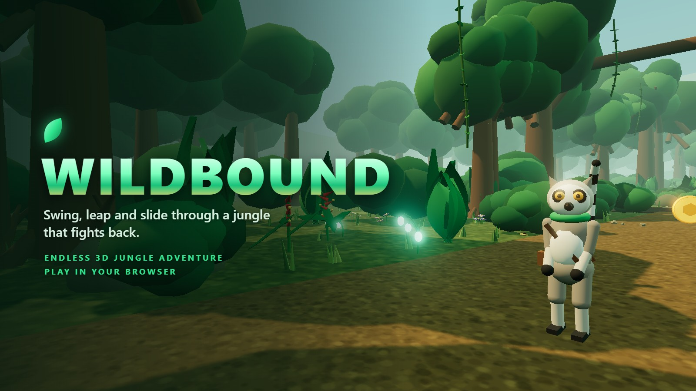
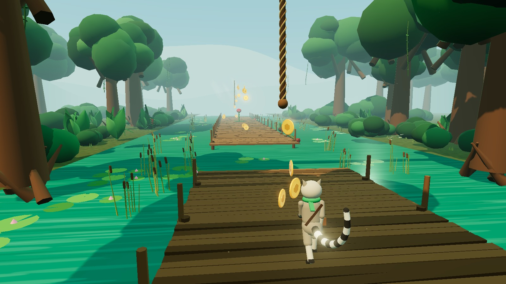
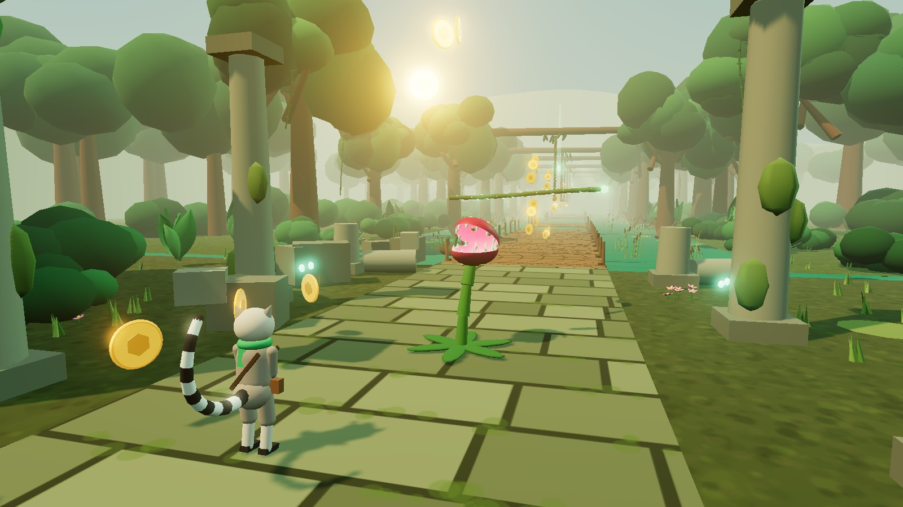
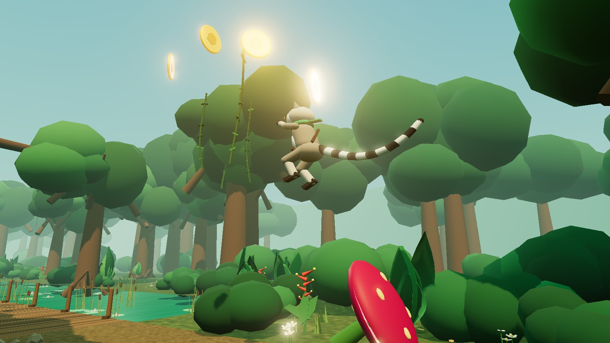

<p align="center">
  
</p>

<h1 align="center">WILDBOUND</h1>

<p align="center">
  <b>Swing, leap and slide through an endless jungle that fights back.</b><br>
  A 3D jungle adventure you play right in your browser.
</p>

<p align="center">
  <a href="https://hafsa2n.github.io/Wildbound/"></a>
</p>

<p align="center">
  
  
  
  
</p>

---

## About

You are a ring-tailed lemur in an emerald bandana, running deeper into the **Emerald Jungle**. The path never ends, the jungle keeps changing, and the plants are out to get you.

Swing across ravines on ropes, read each plant's warning before it strikes, and turn the jungle's own traps into tools. How far can you get?

## Screenshots

<table>
  <tr>
    <td></td>
    <td></td>
  </tr>
  <tr>
    <td align="center"><b>Rope swinging</b>: real pendulum physics. Time your release.</td>
    <td align="center"><b>River Crossing</b>: a boardwalk over open water.</td>
  </tr>
  <tr>
    <td></td>
    <td></td>
  </tr>
  <tr>
    <td align="center"><b>Ancient Ruins</b>: a Snapjaw about to bite.</td>
    <td align="center"><b>Plants as tools</b>: bounce off a dazed Snapjaw.</td>
  </tr>
  <tr>
    <td></td>
    <td></td>
  </tr>
  <tr>
    <td align="center"><b>Night falls</b>: glowing plants light the way.</td>
    <td align="center"><b>Snapjaw</b>: learn its rhythm.</td>
  </tr>
</table>

## Features

- **Endless, ever-changing jungle**: the world is built ahead of you as you run, through three zones that loop and get harder:
  **Emerald Trail → River Crossing → Ancient Ruins → …**
- **Rope swinging with real physics**: every rope is a pendulum. Pump to build height, then let go at the right moment to fly further.
- **Plants that fight back**, each with a warning you can learn, a way past it, and a penalty for getting it wrong.
- **Plants as tools**: the same plants that hurt you can launch you. Bounce off a dazed Snapjaw, or get flung by a lifted Thornlash.
- **Swing chains**: catch ropes and bounce off plants without touching the ground. Coins are worth up to ×5 mid-chain, with a bonus when you land.
- **Day and night**: the further you run, the later it gets. Sunset turns to moonlight, and glowing emerald bells light the path.
- **Gold Coins and Emerald Relics**: coins are saved between runs. Relics are hidden where only a well-timed swing reaches them.
- **You set the pace**: no auto-run. Stop, wait for an opening, then go.

## Controls

| Key | Running | On a rope | Menus |
|---|---|---|---|
| **↑** | Run forward | Pump forward | |
| **↓** | Slow down · tap while running to **slide** | Pump backward | |
| **← →** | Steer | | |
| **Space** | Jump (ropes are grabbed automatically) | Let go | Start · run again |
| **Esc** | | | Back to the title screen |

> WILDBOUND needs a keyboard, so play it on a computer.

## The jungle's plants

| Plant | Warning | How to get past | Use it as a tool |
|---|---|---|---|
| **Snapjaw** | Its jaws slowly open and the mouth glows | Wait for the bite, then dash past while it's dazed, or sidestep during the warning | While dazed (gold stars circle its head), land on its head to **bounce** high |
| **Thornlash** (low) | It rears up, shakes, and its thorns glow red | **Jump** over the sweep | Once lifted (thorns turn green), jump into it to get **flung** |
| **Thornlash** (high) | Same as above | **Slide** under the sweep | Same as above |

**Tip:** coins hanging high above a plant are a hint that it can launch you up to them.

## How it's built

WILDBOUND is written in plain JavaScript with **[three.js](https://threejs.org/)** and **[Vite](https://vitejs.dev/)**, with no game engine. Everything you see, including the lemur, trees, plants, water and textures, is **built from code**. There are no downloaded 3D models or image files.

Techniques used:

- **Endless world streaming**: the course is made of hand-designed *patterns* (a ravine with a rope, a Snapjaw, a pair of lashes) strung together by zone. New chunks are built ahead of the player and cleared behind.
- **Time-sliced building**: each chunk plans its layout instantly, then does the heavy geometry work a few milliseconds per frame, so streaming never stutters.
- **Static batching with vertex colours**: thousands of leaves, flowers and rocks are merged into a few meshes per chunk, which roughly halved the draw calls.
- **Instanced rendering**: every coin in the world is drawn in a single draw call.
- **GPU wind**: grass, plants and canopies sway in a custom vertex shader.
- **Pendulum physics** for ropes, a **state machine** for the player (run, jump, fall, slide, swing), and **hierarchical joint animation** for the lemur, including a ringed tail with follow-through.
- **Atmosphere**: a gradient sky, distant ridges, sun shafts, drifting pollen and fireflies, bloom, and colours that blend between zones and through day and night.

### Project structure

```
src/
├── Game.js              # the game: renderer, camera, modes, run state, main loop
├── config.js            # shared tuning constants (gravity, rope size, start point)
├── main.js              # entry point
├── player/
│   ├── Player.js        # movement, jumping, sliding, swinging, health, chains
│   └── Lemur.js         # the animated character
├── enemies/
│   ├── Snapjaw.js       # the biting plant
│   └── Thornlash.js     # the sweeping thorn vine
├── world/
│   ├── endless/         # Course (streaming), Chunk, patterns, zones
│   ├── scenery/         # prefabs, flora, painted textures
│   ├── batch.js         # merging scenery into few draw calls
│   ├── Rope.js          # pendulum ropes
│   ├── Collectibles.js  # coins (instanced) and relics
│   ├── Water.js         # rivers and waterfalls
│   └── Atmosphere.js    # sky, ridges, light shafts, day and night
├── ui/                  # HUD and title screen
├── styles/              # base, HUD and title styles
└── utils/math.js        # small shared helpers
```

## Run it locally

You need [Node.js](https://nodejs.org/) 20.19 or newer.

```bash
git clone https://github.com/Hafsa2N/Wildbound.git
cd Wildbound
npm install
npm run dev
```

Then open **http://localhost:5173/Wildbound/**.

```bash
npm run build     # production build into dist/
npm run preview   # serve the production build locally
```

## Deployment

Every push to `main` builds the game and publishes it to **GitHub Pages** using the workflow in [`.github/workflows/deploy.yml`](.github/workflows/deploy.yml).

## Roadmap

- [ ] Sound and music
- [ ] Touch controls for phones and tablets
- [ ] More worlds: Azure Riverlands, the Canopy, the Forgotten Temple
- [ ] A shop where Gold Coins buy outfits for the lemur
- [ ] A hidden fifth world, unlocked by an emblem from each world

## Credits

Created by **[Hafsa2N](https://github.com/Hafsa2N)**.
Built with [three.js](https://threejs.org/) and [Vite](https://vitejs.dev/).

## License

No license has been chosen yet, so all rights are reserved by default.